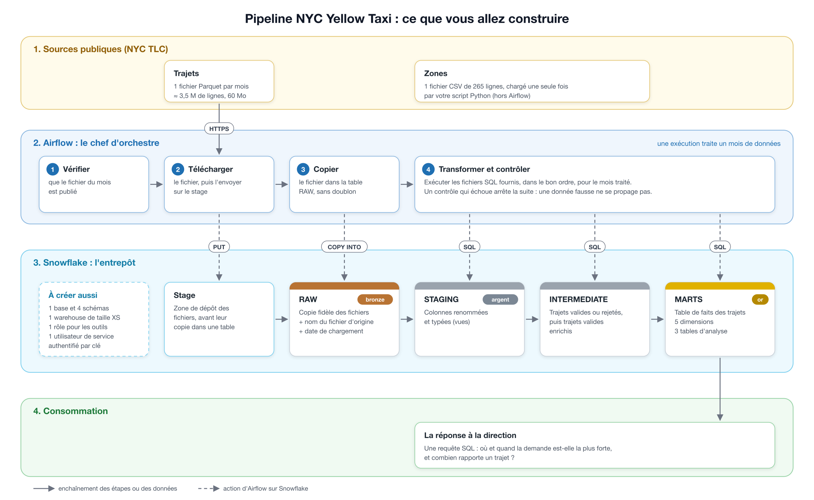
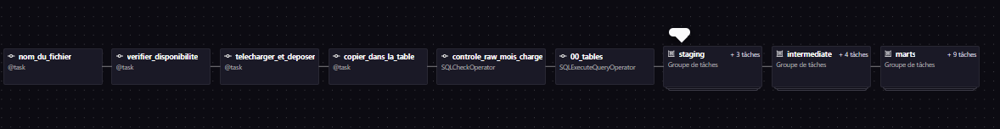
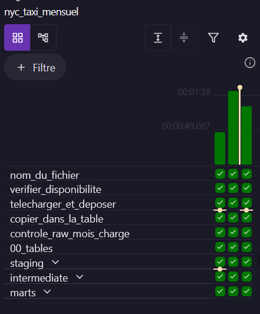
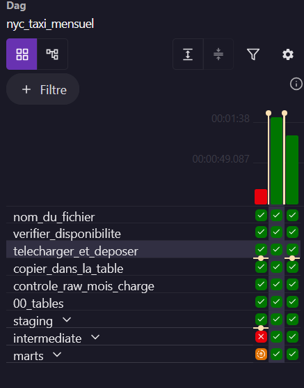
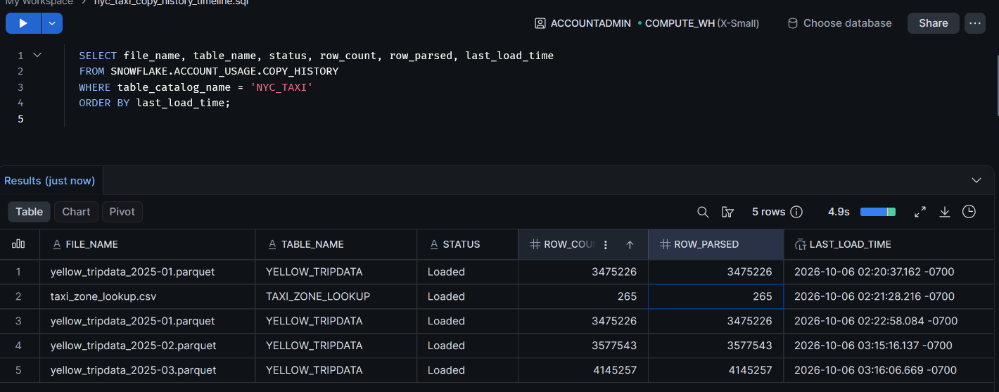
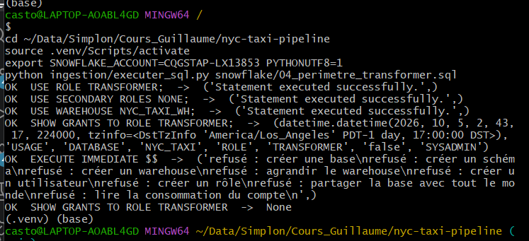
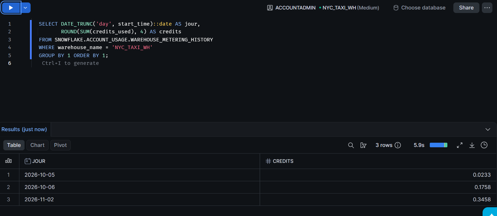

# Pipeline médaillon NYC Yellow Taxi — Snowflake et Airflow

Pipeline qui charge chaque mois les trajets des taxis jaunes de New York (fichiers publics de la TLC) dans Snowflake, les nettoie, les contrôle et les met en forme pour répondre à la direction d'Hudson Cab Partners : **où et quand la demande est la plus forte, et combien rapporte un trajet**.

La réponse est dans [docs/REPONSE.md](docs/REPONSE.md).



## Résultat

Un DAG Airflow, `nyc_taxi_mensuel`, traite un mois par exécution : janvier, février et mars 2025.

| Table | Lignes après les trois mois |
|---|---|
| `RAW.YELLOW_TRIPDATA` | 11 198 026 |
| `RAW.TAXI_ZONE_LOOKUP` | 265 |
| `INTERMEDIATE.INT_TRIPS__FLAGGED` | 11 198 026 |
| `MARTS.FCT_TRIPS` | 10 382 378 trajets valides |
| `MARTS.MART_ZONE_HOURLY_DEMAND` | 11 524 |
| `MARTS.MART_DATA_QUALITY` | 18 |

Ces chiffres sont ceux attendus par le brief. Relancer un mois ne les change pas.

## Le rôle de chaque outil

| Outil | Rôle dans le schéma |
|---|---|
| **Fichiers TLC** (site public) | la source : un fichier Parquet par mois, plus la liste des zones en CSV |
| **Script Python** (`ingestion/`) | charger un mois à la main : téléchargement, `PUT` sur le stage, `COPY INTO` ; il sert à mettre au point le chargement avant de l'automatiser |
| **Snowflake** | l'entrepôt : il stocke les quatre couches et exécute tout le SQL, sur un warehouse XS |
| **Airflow** (Astro CLI, Docker) | l'orchestrateur : chaque mois, il charge le fichier, lance les fichiers SQL dans l'ordre et arrête la chaîne si un contrôle échoue ; il ne calcule rien lui-même |

## Les quatre couches

| Couche | Contenu | Écrite par |
|---|---|---|
| `RAW` | copie fidèle des fichiers, plus le nom du fichier et l'heure de chargement | `PUT` puis `COPY INTO` |
| `STAGING` | vues de renommage et de typage, tables de codes TLC | fichiers SQL fournis |
| `INTERMEDIATE` | chaque trajet avec sa raison de rejet, puis les trajets valides dédoublonnés et enrichis | fichiers SQL fournis |
| `MARTS` | 5 dimensions, la table de faits et 3 tables d'analyse | fichiers SQL fournis |

## Le DAG



```
nom_du_fichier → verifier_disponibilite → telecharger_et_deposer → copier_dans_la_table
  → controle_raw_mois_charge → 00_tables
  → staging (codes_tlc, stg_tlc__taxi_zones, stg_tlc__yellow_trips)
  → intermediate (int_trips__flagged → contrôle trop d'écartés → int_trips__enriched → contrôle doublons)
  → marts (5 dimensions + fct_trips → mart_daily_revenue, mart_zone_hourly_demand ; mart_data_quality)
```

- **Le fichier vient de la date logique du run, pas de la date du jour.** Le run du 1er février charge `yellow_tripdata_2025-02.parquet`, même relancé des mois plus tard.
- **Chaque run est rejouable.** Le `PUT` sans `OVERWRITE` et le `COPY INTO` sans `FORCE` ne rechargent pas un fichier déjà chargé. Les grosses tables effacent le mois traité avant de le réinsérer, et les petites sont recalculées en entier.
- **Trois contrôles arrêtent la chaîne si les données sont mauvaises** :

  | Contrôle | Vérifie que |
  |---|---|
  | `raw_mois_charge` (fourni) | le mois est présent dans RAW |
  | `int_trop_ecartes` | moins de 10 % des trajets du mois sont écartés (constaté : 6,4 à 7,7 %) |
  | `int_pas_de_doublon` | aucun trajet valide n'apparaît deux fois |

  Test fait : avec le seuil abaissé à 5 %, le contrôle de janvier échoue et les 11 tâches suivantes passent en `upstream_failed`.

## Sécurité

- **Utilisateur de service `AIRFLOW_SVC`** (`TYPE = SERVICE`), sans mot de passe : il se connecte uniquement par paire de clés.
- **Rôle des outils `TRANSFORMER`** : il peut utiliser le warehouse et créer des tables, des vues, un stage et des formats de fichier dans les 4 schémas, et il possède ce qu'il crée. Il ne peut ni créer de base, de schéma, de warehouse, d'utilisateur ou de rôle, ni redimensionner le warehouse, ni lire la facturation. La preuve est dans [snowflake/04_perimetre_transformer.sql](snowflake/04_perimetre_transformer.sql).
- **Aucun secret dans le dépôt ni dans l'image Docker.** La clé privée reste hors du projet (`~/.ssh/snowflake/rsa_key.p8`). Airflow la lit dans `airflow/.env`, qui est exclu de Git et de l'image par `.gitignore` et `.dockerignore`.

## Relancer le projet

### Prérequis

Python 3.10 ou plus récent, Git, OpenSSL, Docker Desktop, [Astro CLI](https://www.astronomer.io/docs/astro/cli/install-cli) et un compte Snowflake avec `ACCOUNTADMIN`. `bash verifier_poste.sh` vérifie le poste.

### 1. L'entrepôt Snowflake (une fois, par un humain)

Dans Snowsight, exécuter [snowflake/01_infra.sql](snowflake/01_infra.sql) avec **Run All**, puis contrôler avec `01_infra_verifications.sql`.

### 2. La paire de clés

```bash
mkdir -p ~/.ssh/snowflake && cd ~/.ssh/snowflake
openssl genrsa 2048 | openssl pkcs8 -topk8 -inform PEM -out rsa_key.p8 -nocrypt
openssl rsa -in rsa_key.p8 -pubout -out rsa_key.pub
chmod 600 rsa_key.p8
grep -v -- '-----' rsa_key.pub | tr -d '\n'     # clé publique sur une ligne
```

Dans Snowsight, avec `SECURITYADMIN` : `ALTER USER AIRFLOW_SVC SET RSA_PUBLIC_KEY='<clé publique sur une ligne>';`

### 3. La couche RAW et le test de connexion

```bash
python -m venv .venv
source .venv/bin/activate              # Windows (Git Bash) : source .venv/Scripts/activate
pip install -r ingestion/requirements.txt
export SNOWFLAKE_ACCOUNT=ORGANISATION-COMPTE
python ingestion/test_connexion.py     # affiche AIRFLOW_SVC | TRANSFORMER | NYC_TAXI_WH
python ingestion/executer_sql.py snowflake/02_raw.sql
python ingestion/charger_mois.py --zones
python ingestion/charger_mois.py --month 2025-01    # facultatif : Airflow le fait aussi
```

### 4. Airflow

```bash
cd airflow
cp .env.example .env
awk 'NF {printf "%s\\n", $0}' ~/.ssh/snowflake/rsa_key.p8   # clé sur une ligne, à coller dans .env
astro dev start                                             # interface : http://localhost:8080
```

1. Lancer `test_connexion_snowflake` avec **Trigger**. C'est le seul DAG à déclencher à la main.
2. Activer `nyc_taxi_mensuel` avec son **interrupteur**, sans Trigger : il rejoue janvier, février et mars.

## Choix et pièges rencontrés

| Sujet | Ce qui s'est passé | Choix retenu |
|---|---|---|
| Stage interne | `COPY INTO` ne lit que des fichiers déjà dans un stage. Un stage interne évite de créer un compte de stockage cloud (S3, Azure) et ses identifiants. Snowflake y garde l'historique de chargement de chaque fichier, ce qui rend le rechargement sans doublon. | `TLC_STAGE`, fichiers déposés à la racine |
| Warehouse XS | 11 millions de lignes par trimestre tiennent sur la plus petite taille (1 crédit par heure au plus). Le warehouse s'arrête 60 s après la dernière requête et redémarre tout seul. | `XSMALL`, `AUTO_SUSPEND = 60`, `AUTO_RESUME = TRUE` |
| Rôle des outils | Le pipeline n'a besoin que de créer et de remplir ses propres tables. Avec `ACCOUNTADMIN`, une erreur ou une clé volée toucheraient tout le compte. | `TRANSFORMER` : droits limités à la base `NYC_TAXI`, aucun droit sur le compte |
| Dates Parquet | Au premier chargement, les dates étaient en l'an 55 000 000 : les fichiers stockent des microsecondes, que Snowflake lit mal par défaut. | `USE_LOGICAL_TYPE = TRUE` dans le format `PARQUET_FF` |
| Types RAW | Une colonne peut être entière un mois et décimale le suivant, et `NUMBER` sans décimales arrondit les montants. | `NUMBER` pour les codes et les compteurs, `FLOAT` pour les montants et les distances |
| `_source_file` | Le contrat exige le nom nu du fichier. | Dépôt à la racine du stage, avec `AUTO_COMPRESS = FALSE` pour éviter le suffixe `.gz` |
| Ajouter des tâches à un DAG déjà exécuté | Airflow 3 lie chaque run à la version du DAG qui l'a créé : un simple Clear ignore les nouvelles tâches. | Clear avec l'option **Run on latest version** |
| Contrôles | Relancer un contrôle ne change pas les données. | `retries = 0` sur les contrôles |
| Mémoire du poste | Avec peu de RAM libre, des tâches étaient tuées au démarrage. | `max_active_tasks = 3` |
| Windows | Le kit recommande WSL. Ce projet a été mené directement sous Windows (Git Bash, Docker Desktop, Astro CLI via winget). | Clé hors du projet, lisible par le seul compte Windows ; `.gitattributes` force les fins de ligne LF pour les conteneurs Linux |
| Port Postgres | Le port 5432 était déjà pris sur le poste. | `astro config set postgres.port 5439` |

## Vérifications

| Vérification | Fichier | Résultat |
|---|---|---|
| Comptage des anomalies de janvier à la main | [snowflake/03_comptage_anomalies.sql](snowflake/03_comptage_anomalies.sql) | 223 889 trajets anormaux, comme dans `MART_DATA_QUALITY`. Les comptes par règle diffèrent, car le rapport ne retient que la première règle enfreinte. |
| Périmètre du rôle des outils | [snowflake/04_perimetre_transformer.sql](snowflake/04_perimetre_transformer.sql) | toutes les tentatives hors périmètre sont refusées (capture 5) |
| Crédits consommés | [snowflake/05_credits_consommes.sql](snowflake/05_credits_consommes.sql) | voir la capture 6 |
| Rejeu de février | relance complète du run | nombre de lignes identique dans les 9 tables |

## Captures d'écran

| Capture | Ce qu'elle montre |
|---|---|
|  | les trois exécutions réussies : janvier, février, mars |
|  | le graphe du DAG, groupes dépliés |
|  | un contrôle en échec, et les tâches suivantes en `upstream_failed` |
|  | l'historique de chargement Snowflake (`COPY_HISTORY`) |
|  | les droits du rôle des outils, et les accès refusés hors de son périmètre |
|  | le suivi des crédits consommés |

## Auteur

Sacha Tymoshenko, Simplon, formation Data Engineer. Brief réalisé seul, sans binôme.

## Contenu du dépôt

```
├── snowflake/       01 infrastructure, 02 couche RAW, 03 à 05 vérifications
├── ingestion/       connexion, chargement d'un mois, exécution d'un fichier SQL, exploration
├── airflow/
│   ├── dags/        nyc_taxi_mensuel.py, test_connexion_snowflake.py
│   └── include/sql/ SQL fourni (non modifié) et contrôles ajoutés
├── docs/            fiche source, réponse à la direction, schémas
├── CONTRAT_RAW.md   noms et colonnes imposés à la couche RAW
└── ETAPES.md        le déroulé du brief, jour par jour
```
